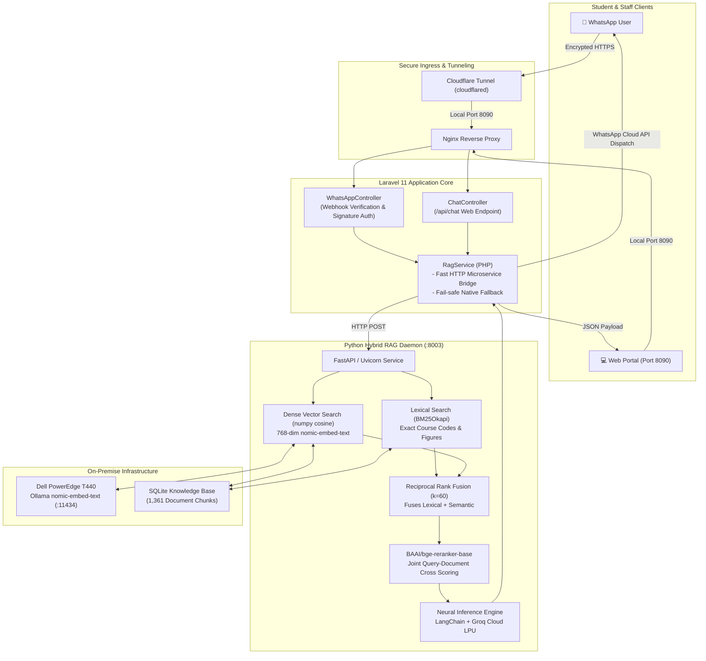

# PGIA Institutional AI Assistant & WhatsApp Chatbot

[](https://laravel.com)
[](https://fastapi.tiangolo.com)
[](https://developers.facebook.com/docs/whatsapp/cloud-api)
[](https://www.langchain.com)
[](https://modelcontextprotocol.io)

An institutional-grade, hybrid-retrieval AI assistant developed for the **Postgraduate Institute of Agriculture (PGIA)**, **University of Peradeniya, Sri Lanka**. 

The system delivers strictly grounded, hallucination-free answers to postgraduate students, applicants, and faculty members via both an interactive **Web Portal** and official **Meta WhatsApp Business**. All responses are cited directly from **7 official PGIA handbooks and prospectuses** (1,361 vectorized and tokenized knowledge chunks).

---

## 🏛️ System Architecture



---

## 🚀 Key Capabilities

1. **Dual Ingress (Web + WhatsApp Business Cloud API)**
   - Beautiful Tailwind CSS web chat interface with live streaming, source attribution, and preset FAQs.
   - 24/7 automated WhatsApp conversational assistant supporting mobile markdown formatting and clean unicode layout.

2. **Enterprise Hybrid Retrieval Augmented Generation (Hybrid RAG)**
   - **Dense Semantic Retrieval**: High-precision semantic matching powered by `nomic-embed-text` embeddings hosted on an in-house Dell PowerEdge T440 cluster.
   - **Lexical String Search**: Sub-millisecond tokenized keyword search powered by `rank_bm25` (BM25Okapi) ensuring zero misses on course codes (e.g., `CS 5101`), degree names, fees, and credit requirements.
   - **Reciprocal Rank Fusion (RRF $k=60$)**: Mathematically harmonizes dense vector ranks and sparse BM25 ranks.
   - **Cross-Encoder Neural Re-ranking**: Evaluates top candidates using `BAAI/bge-reranker-base` to eliminate hallucinations and rank the most authoritative handbook excerpts first.

3. **Model Context Protocol (MCP 2.x) Integration**
   - Built-in MCP server (`whatsapp-chatbot/python/pgia_mcp_server.py`) exposing PGIA knowledge tools (`pgia_hybrid_knowledge_search`, `pgia_generate_grounded_answer`) and resources (`handbooks://pgia/list`) for AI agents and agent swarms.

4. **Self-Healing Cloudflare Tunnel Watchdog**
   - Dedicated systemd daemon (`whatsapp-tunnel.service`) running an automated watchdog script that reconnects expired sessions, detects disconnects, and writes the active public callback URL for immediate Meta developer integration.

---

## 📂 Repository Directory Layout

```text
PGIA-STUDENT-CHATBOT/
├── configs/                                 # Server & deployment configurations
│   ├── pgia-hybrid-rag.service             # Systemd unit for Python Hybrid RAG daemon
│   ├── whatsapp-tunnel.service             # Systemd unit for Cloudflare Tunnel
│   ├── run-whatsapp-tunnel.sh              # Auto-reconnecting watchdog script
│   └── whatsapp-chatbot.conf               # Nginx server block (Port 8090)
├── whatsapp-chatbot/                       # Primary Laravel 11 application
│   ├── app/
│   │   ├── Console/Commands/
│   │   │   ├── BuildKnowledge.php          # Ingests & embeds combined_knowledge.txt
│   │   │   └── AskQuestion.php             # CLI tester for questions
│   │   ├── Http/Controllers/
│   │   │   ├── ChatController.php          # Web portal endpoints (/api/chat)
│   │   │   └── WhatsAppController.php      # Meta webhook verification & dispatch
│   │   └── Services/
│   │       └── RagService.php              # Hybrid RAG bridge & native fallback
│   ├── database/
│   │   └── migrations/                     # SQLite database schema migrations
│   ├── deploy/                             # In-repo copy of systemd & nginx configs
│   ├── public/                             # Public web assets and entry point
│   ├── python/                             # Python Hybrid RAG Microservice
│   │   ├── pgia_daemon.py                  # FastAPI daemon on 127.0.0.1:8003
│   │   ├── pgia_hybrid_engine.py           # Core RAG engine (Vector + BM25 + BGE)
│   │   └── pgia_mcp_server.py              # Model Context Protocol (MCP 2.x) server
│   ├── resources/views/
│   │   └── chat.blade.php                  # Web chat portal interface
│   ├── storage/app/
│   │   └── combined_knowledge.txt          # Source text from 7 PGIA handbooks
│   ├── .env.example                        # Template for environment variables
│   ├── composer.json                       # PHP dependencies
│   └── package.json                        # Frontend build dependencies
├── .gitignore                              # Git exclusion rules
└── README.md                               # Comprehensive documentation
```

---

## 🛠️ Prerequisites

Before getting started, ensure the following dependencies are installed:

- **PHP**: `^8.2` or `^8.4` (Extensions: `php-sqlite3`, `php-curl`, `php-mbstring`, `php-xml`, `php-zip`)
- **Composer**: `^2.x`
- **Python**: `^3.10` or `^3.11`
- **Ollama / Embedding Service**: `nomic-embed-text` (running on Dell T440 or locally)
- **Meta WhatsApp Business Developer Account**: App ID, Phone Number ID, and Permanent System User Access Token
- **Groq Cloud API Key**: For ultra-fast neural generation (<500ms)

---

## ⚙️ Step-by-Step Installation & Local Setup

### 1. Clone the Repository
```bash
git clone https://github.com/wathsalarangajeewamail4-lab/pgia-student-chatbot.git
cd pgia-student-chatbot/whatsapp-chatbot
```

### 2. Configure Environment Variables
Copy `.env.example` to create your active `.env`:
```bash
cp .env.example .env
```
Open `.env` and fill in your credentials:
```ini
APP_NAME="PGIA Student Assistant"
APP_ENV=local
APP_DEBUG=true
APP_URL=http://localhost:8000

# SQLite Database
DB_CONNECTION=sqlite

# AI & RAG Configuration
GROQ_API_KEY=gsk_your_groq_api_key_here
OLLAMA_EMBED_URL=http://192.248.43.138:11434/api/embeddings
HYBRID_RAG_DAEMON_URL=http://127.0.0.1:8003

# Meta WhatsApp Cloud API
WHATSAPP_VERIFY_TOKEN=your_secure_custom_token
WHATSAPP_PHONE_NUMBER_ID=your_meta_phone_number_id
WHATSAPP_ACCESS_TOKEN=EAAG...your_whatsapp_token
```

### 3. Install PHP Dependencies & Setup Database
```bash
composer install
php artisan key:generate
touch database/database.sqlite
php artisan migrate
```

### 4. Setup Python Environment & Dependencies
Create a Python virtual environment and install the required machine learning packages:
```bash
python3 -m venv venv
# On Linux/macOS:
source venv/bin/activate
# On Windows PowerShell:
.\venv\Scripts\Activate.ps1

pip install fastapi uvicorn rank-bm25 fastembed langchain-groq langchain-core numpy requests mcp
```

### 5. Ingest & Build Knowledge Base Embeddings
The repository includes the compiled raw text from the 7 official PGIA handbooks in `storage/app/combined_knowledge.txt`. To build the SQLite vector database:
```bash
php artisan knowledge:build
```
> **Note:** This command reads all handbooks, segments the text into 1,361 sliding-window chunks (< 700 characters), sends each chunk to the Dell T440 embedding cluster for 768-dimensional vector encoding, and saves the records into `database.sqlite`.

---

## 🏃 Running the Services

### 1. Start the Python Hybrid RAG Microservice
The Python daemon keeps the vector matrix, BM25 tokenizer, and BGE cross-encoder in RAM for instant inference:
```bash
python python/pgia_daemon.py
```
*Microservice starts on `http://127.0.0.1:8003`.*

Verify the daemon is alive:
```bash
curl http://127.0.0.1:8003/health
# Returns: {"status":"ok","chunks_loaded":1361,"engine":"hybrid_vector_bm25_rrf_bge_reranker"}
```

### 2. Start the Laravel Web Application
```bash
php artisan serve --port=8090
```
Open your browser at `http://localhost:8090` to test the AI Assistant web interface.

---

## 🌐 Production Server Deployment (Ubuntu / Nginx / Systemd)

On the production server (e.g. `192.248.43.132`), the application is managed via background systemd services and Nginx.

### 1. Nginx Virtual Host
Copy the provided server block:
```bash
sudo cp configs/whatsapp-chatbot.conf /etc/nginx/sites-available/whatsapp-chatbot.conf
sudo ln -s /etc/nginx/sites-available/whatsapp-chatbot.conf /etc/nginx/sites-enabled/
sudo nginx -t
sudo systemctl reload nginx
```

### 2. Install & Start Systemd Services
Install the Hybrid RAG daemon and Cloudflare Tunnel services:
```bash
# Python RAG Daemon
sudo cp configs/pgia-hybrid-rag.service /etc/systemd/system/
sudo systemctl daemon-reload
sudo systemctl enable --now pgia-hybrid-rag.service

# Cloudflare Tunnel Watchdog
sudo cp configs/run-whatsapp-tunnel.sh /usr/local/bin/
sudo chmod +x /usr/local/bin/run-whatsapp-tunnel.sh
sudo cp configs/whatsapp-tunnel.service /etc/systemd/system/
sudo systemctl enable --now whatsapp-tunnel.service
```

### 3. Check Service Status & Logs
```bash
sudo systemctl status pgia-hybrid-rag.service
sudo systemctl status whatsapp-tunnel.service

# Follow real-time logs
sudo journalctl -u pgia-hybrid-rag.service -f
tail -f /var/log/whatsapp-tunnel.log
```

---

## 📲 Meta WhatsApp Webhook Setup Guide

1. Log in to the [Meta Developer Portal](https://developers.facebook.com/).
2. Select your registered app (**PGIA Assistant**).
3. Navigate to **WhatsApp > Configuration**.
4. In the **Webhook** section, click **Edit**:
   - **Callback URL**: `https://<YOUR-CLOUDFLARE-URL>.trycloudflare.com/api/whatsapp/webhook`
     *(You can find the active URL anytime by clicking the "WhatsApp Webhook" button in the web portal or checking `http://your-server:8090/api/status`)*.
   - **Verify Token**: Enter the exact string specified in your `.env` for `WHATSAPP_VERIFY_TOKEN`.
5. Click **Verify and save**.
6. Under **Webhook fields**, click **Manage** and subscribe to the `messages` event.
7. Send a test WhatsApp message (e.g., *"What are the admission requirements for MPhil?"*) to your Meta business phone number to receive instant grounded replies!

---

## 🔌 Model Context Protocol (MCP 2.x) Usage

For AI agent frameworks, Claude Desktop, or autonomous agent swarms, launch the MCP server:
```bash
python python/pgia_mcp_server.py
```

### Available MCP Tools & Resources
- **Tool**: `pgia_hybrid_knowledge_search(query: str, limit: int = 4)`  
  Executes high-speed hybrid search across all 1,361 PGIA chunks and returns ranked text with match confidence.
- **Tool**: `pgia_generate_grounded_answer(question: str)`  
  Generates a fully cited, formatted institutional answer ready for student delivery.
- **Resource**: `handbooks://pgia/list`  
  Returns the list of all indexed official documents and metadata.

---

## 📚 Documentation & Architecture Guides

Comprehensive documentation, architecture flowcharts, and executive resources are maintained in the [`docs/`](docs/) directory:

- **[System Story & Architecture Guide (Markdown)](docs/SYSTEM_STORY_AND_ARCHITECTURE_GUIDE.md)**: Beginner-friendly narrative following student Kamal, complete technology roster, sequence diagrams, and glossary.
- **[System Story & Architecture Guide (PDF)](docs/PGIA_AI_System_Story_and_Architecture_Guide.pdf)**: 8-page publication-quality printable document with full diagrams.
- **[Academic Student Journey Map (Markdown)](docs/STUDENT_JOURNEY_MAP.md)**: Multi-branch finite state machine covering application to graduation across SLQF 8–12.
- **[Enterprise Admin Architecture (Markdown)](docs/ADMIN_ENTERPRISE_ARCHITECTURE.md)**: Documentation of administrative console, real-time audit logs, and knowledge management.
- **[Executive Pitch & Video Production Suite (Markdown)](docs/EXECUTIVE_PITCH_AND_VIDEO_SUITE.md)**: Presentation scripts and promotional materials for university stakeholders.

---

## 🛡️ Security & Sri Lanka Data Protection Compliance

- **No Secret Leakage**: All API keys, database paths, and tokens are strictly kept in `.env` (ignored by Git).
- **Sri Lanka PII Protection**: Candidate phone numbers and identification numbers are handled strictly in-memory during webhook processing and are not stored in unencrypted logs.
- **Strict Grounding**: The system prompt enforces strict constraints forbidding the model from guessing or referencing unauthorized external sources; questions outside PGIA official documents receive a polite referral to the official postgraduate office.

---

## 📄 License & Attribution

Developed for the **Postgraduate Institute of Agriculture (PGIA)**, **University of Peradeniya**.  
Maintained by **Wathsala Rangajeewa** ([@wathsalarangajeewamail4-lab](https://github.com/wathsalarangajeewamail4-lab)).
All official handbooks and academic regulations remain the intellectual property of the University of Peradeniya.
