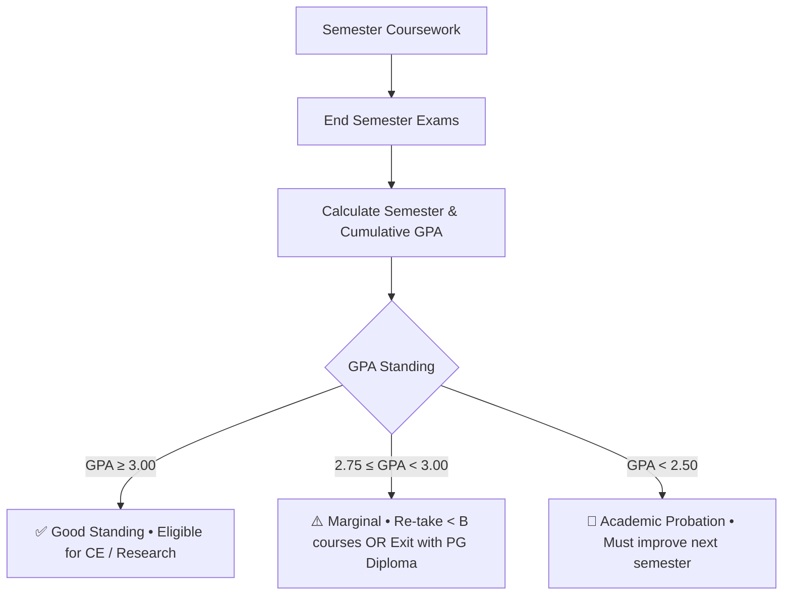
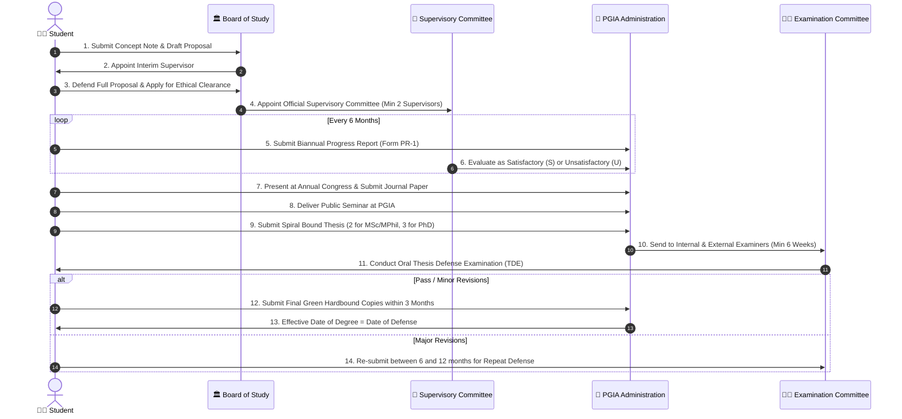

# 🗺️ PGIA Student Academic Journey Map & Decision Architecture

> **Synthesized from Official University Documentation:**  
> • *PGIA Student Handbook 2026*  
> • *PGIA Postgraduate Prospectus 2024*  
> • *PGIA Comprehensive Institutional FAQ (18 Pages)*  
> • *PGIA Research Guidelines for M.Sc. & MBA (SLQF 10)*  
> • *PGIA Research Guidelines for M.Phil. & Ph.D. (SLQF 11 & 12)*  
> • *PGIA Examination Regulations for Comprehensive Examination*  
> • *PGIA Directed Study Guidelines (2017 Onwards)*  
> • *PGIA Ethical Clearance & Progress Presentation Charters*  

---

## 1. High-Level Master Academic Lifecycle Map

```mermaid
flowchart TD
    classDef admissions fill:#1e293b,stroke:#38bdf8,stroke-width:2px,color:#f8fafc;
    classDef coursework fill:#1e293b,stroke:#a855f7,stroke-width:2px,color:#f8fafc;
    classDef exam fill:#1e293b,stroke:#f59e0b,stroke-width:2px,color:#f8fafc;
    classDef research fill:#1e293b,stroke:#10b981,stroke-width:2px,color:#f8fafc;
    classDef exit fill:#7f1d1d,stroke:#ef4444,stroke-width:2px,color:#f8fafc;
    classDef convocation fill:#14532d,stroke:#22c55e,stroke-width:2px,color:#f8fafc;

    subgraph Phase1["STAGE 1: ADMISSIONS & ONBOARDING"]
        App["📝 Application Submission<br/>(Online Portal / Form + Docs)"]:::admissions
        Eval["📋 Board of Study Evaluation<br/>(Aptitude Test / Interview / Pre-reqs)"]:::admissions
        Reg["🎓 Registration & MIS Enrollment<br/>(Fees Paid • Student ID • MIS Login)"]:::admissions
    end

    subgraph Phase2["STAGE 2: COURSEWORK & CORE ASSESSMENTS"]
        CW["📚 Course Enrolment via MIS<br/>(2-week Drop/Add • Continuous Assessments)"]:::coursework
        GPACheck{"⚖️ Final GPA Check<br/>(Scale: 4.00)"}:::coursework
    end

    subgraph Phase3["STAGE 3: PATHWAY BRANCHING & MILESTONES"]
        TrackPGD["📜 Track A: PG Diploma<br/>(SLQF 8 • 25 Credits • GPA ≥ 2.75)"]:::exit
        TrackCW["🎓 Track B: Masters by CW<br/>(SLQF 9 • 30 Credits • 5-Cr Directed Study)"]:::coursework
        TrackCWR["🔬 Track C: M.Sc. / MBA (CW & R)<br/>(SLQF 10 • 60 Credits: 30 CW + 15-30 Res)"]:::research
        TrackRes["🧬 Track D: M.Phil. / Ph.D.<br/>(SLQF 11 / 12 • Pure Research)"]:::research
    end

    subgraph Phase4["STAGE 4: EXAMINATION & RESEARCH GATES"]
        CE["📝 Comprehensive Examination (CE)<br/>(GPA ≥ 3.00 Required • Max 2 Attempts)"]:::exam
        PropDef["📑 Research Proposal & Ethical Clearance<br/>(Interim Supervisor • Supervisory Committee)"]:::research
        Biannual["📊 Biannual Progress Reports<br/>(Every 6 Months • S/U Grade)"]:::research
        PubReq["📰 Refereed Journal Publication<br/>(M.Sc: 1 submitted • M.Phil: 1 pub+1 sub • Ph.D: 2 pub)"]:::research
        PublicSem["🎤 Public Seminar & Spiral Thesis<br/>(Pre-defense Presentation at PGIA)"]:::research
        TDE["🛡️ Thesis Defense Examination (TDE)<br/>(Oral Viva Voce with 2-3 Examiners)"]:::research
    end

    subgraph Phase5["STAGE 5: FINAL CLEARANCE & CONVOCATION"]
        Hardbound["📗 Green Hardbound Submission<br/>(2-3 Bound Copies + PDF CD within 3 Months)"]:::convocation
        LibClear["🏛️ Library Clearance & ID Invalidation"]:::convocation
        Grad["🎓 Degree Awarded & Convocation<br/>(Alumni Association Network)"]:::convocation
    end

    App --> Eval --> Reg --> CW --> GPACheck

    GPACheck -->|GPA < 2.50| Probation["⚠️ Academic Probation / Retake"]:::exit
    GPACheck -->|GPA 2.75 - 2.99| TrackPGD
    GPACheck -->|GPA ≥ 3.00| TrackCW
    GPACheck -->|GPA ≥ 3.00| TrackCWR
    Reg -->|Research Degrees Entry| TrackRes

    TrackCW --> CE
    TrackCWR --> CE
    TrackCWR --> PropDef

    TrackRes --> PropDef
    PropDef --> Biannual --> PubReq --> PublicSem --> TDE
    CE -->|Pass CE (CW)| Hardbound
    TDE -->|Passed / Minor Revisions| Hardbound
    TDE -->|Major Revisions| Biannual
    TrackPGD --> LibClear
    Hardbound --> LibClear --> Grad
```

---

## 2. Institutional Degree Track Matrix

| Pathway / Degree | SLQF Level | Total Credits | Coursework / Research Breakdown | Minimum GPA | Key Examination Gate | Publication Requirement | Min - Max Duration |
| :--- | :---: | :---: | :---: | :---: | :---: | :---: | :---: |
| **Postgraduate Diploma (PGD)** | Level 8 | 25 Credits | 25 Credits Coursework | **2.75** | Semester Examinations | None | 1 – 3 Years |
| **Masters by Coursework (M.Sc. / MBA)** | Level 9 | 30 Credits | 25 Credits CW + 5 Credits Directed Study / Project | **3.00** | Comprehensive Exam (CE) | None | 1 – 5 Years |
| **M.Sc. (Coursework & Research)** | Level 10 | 60 Credits | 30 Credits CW + 30 Credits Research (or min 15 Res) | **3.00** | CE + Thesis Defense (TDE) | 1 Paper Submitted to Refereed Journal | 2 – 6 Years |
| **MBA (Coursework & Research)** | Level 10 | 60 Credits | 36 Credits CW + 24 Credits Research | **3.00** | CE + Thesis Defense (TDE) | 1 Paper Submitted to Refereed Journal | 2.5 – 6 Years |
| **Master of Philosophy (M.Phil.)** | Level 11 | By Research | Full-time Research (Up to 10 Credits CW free) | N/A | Proposal + TDE | 1 Published + 1 Submitted Paper | 2 – 7 Years |
| **Doctor of Philosophy (Ph.D. / DBA)** | Level 12 | By Research | Full-time Research (Split PhD option available) | N/A | Proposal + TDE | 2 Published Papers in Refereed Journals | 3 – 8 Years |

---

## 3. Detailed Decision Gates & State Transitions

### Gate 1: Coursework, GPA & Grading Architecture
- **Grading Scale**: Grade Point scale from **0.00 (F)** to **4.00 (A+)**.
- **Passing Requirement**:
  - Minimum Final GPA for Masters / M.Sc. / MBA / M.Phil. is **3.00**.
  - Minimum Final GPA for Postgraduate Diploma is **2.75**.
- **Low Grades & Re-takes**:
  - Courses with grades below **B** may be re-taken to improve GPA.
  - An Incomplete grade (`I`) must be resolved within the following semester; the maximum grade achievable on removal of `I` is **B** unless due to certified medical reasons.
- **Academic Probation**:
  - A student whose GPA falls below **2.50** is placed on probation and receives formal counseling from the Board of Study.



---

### Gate 2: The Comprehensive Examination (CE)
Applicable to all **M.Sc. / MBA by Course Work** and **M.Sc. / MBA by Course Work & Research**.

1. **Eligibility Prerequisites**:
   - Registration kept in force during the semester.
   - Satisfactorily completed all coursework credits (30 credits for M.Sc., 36 credits for MBA).
   - Final Grade Point Average (FGPA) $\ge$ **3.00**.
   - Zero incomplete grades (`I`) or pending modular fees.
2. **Format & Evaluation**:
   - Conducted by an Examination Committee appointed by the Board of Study.
   - Evaluates broad mastery, analytical capabilities, and integration across core subject areas.
   - Graded as **Pass** or **Fail**.
3. **Repeat Rules**:
   - If a student fails on the first attempt, **only ONE repeat attempt** is permitted (maximum 2 attempts total).
   - A special approval from the Board of Management is required if repeat is delayed.
4. **Failure Outcome**:
   - If a candidate fails both attempts, they are ineligible for the Master's degree and can **exit with a Postgraduate Diploma (SLQF 8)** provided they have 25 credits with GPA $\ge$ 2.75.

---

### Gate 3: Directed Study / Project (5 Credits)
Compulsory for all **Masters by Course Work** (since 2017):
- **Workload**: 5 credits = 500 notional hours (1 credit = 100 hours).
- **Timeline**:
  - **Week 2**: Board of Study appoints Supervisor; student submits tentative proposal and work plan.
  - **Mid-Semester**: Progress evaluation.
  - **End of Semester**: Final submission of report and oral presentation.
- **Grading**: Grade below `C` requires repeating the study at the very next offering.

---

### Gate 4: Research Pathway Milestones (M.Sc. CW&R, M.Phil., Ph.D.)



---

## 4. Contingency Routes, Upgrades & Early Exit Mechanisms

1. **Upgrading from M.Phil. to Ph.D.**:
   - An M.Phil. candidate may apply to upgrade to Ph.D. after a **minimum of 1 year** of research.
   - Requires demonstrably high research competence, publication progress, and recommendation by the Supervisory Committee and Board of Study.
2. **Downgrading from Ph.D. to M.Phil.**:
   - If a Ph.D. candidate is unable to achieve doctoral-level contributions or fails doctoral defense, the examination committee may recommend the award of an **M.Phil.** if M.Phil. criteria are satisfied.
3. **Early Exit to Postgraduate Diploma (SLQF 8)**:
   - Students in M.Sc. (CW) or M.Sc. (CW & R) who fail the Comprehensive Exam twice or who decide to discontinue research may request early exit with a **Postgraduate Diploma** if they possess $\ge 25\text{ credits}$ with GPA $\ge 2.75$.
4. **Converting M.Sc. (CW & R) to Masters (CW)**:
   - A student registered for M.Sc. (CW & R) may convert to Masters by Coursework (SLQF 9) upon recommendation of the Board of Study, completing a 5-credit Directed Study instead of a research thesis.

---

## 5. Conversational Guidance Architecture for the AI Chatbot

When a student queries the AI Assistant, the RAG engine performs **Contextual State Mapping**:
1. **Identify User Stage**: Determine where the student is in the pipeline (`Applicant`, `Active Coursework`, `Pre-CE`, `Research Active`, `Thesis Writing`, `Graduation Ready`).
2. **Identify Target Degree**: Retrieve rules specifically for their SLQF tier.
3. **Enforce Prerequisite Guards**:
   - e.g., If asking *"How do I register for Thesis Defense?"*, the bot verifies and lists:
     - Coursework finished + GPA $\ge 3.00$.
     - Comprehensive Exam passed.
     - Progress reports submitted every 6 months.
     - Public seminar completed.
     - 1 journal paper submitted.
     - 2 spiral bound copies signed by all supervisors.
4. **Cite Forms & Regulations**: Pinpoints the exact form (`Application for Thesis Defense`, `Form PR-1`, `Comprehensive Exam Form`) and policy clause.
