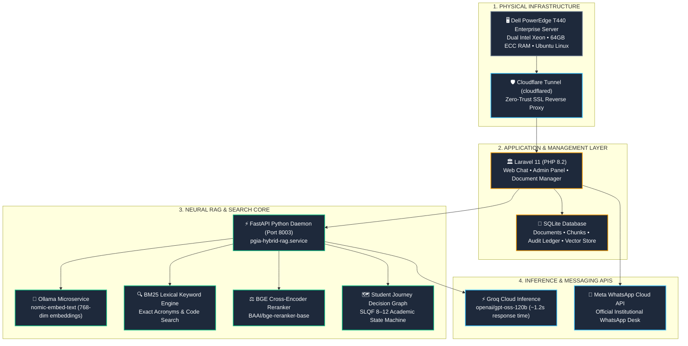
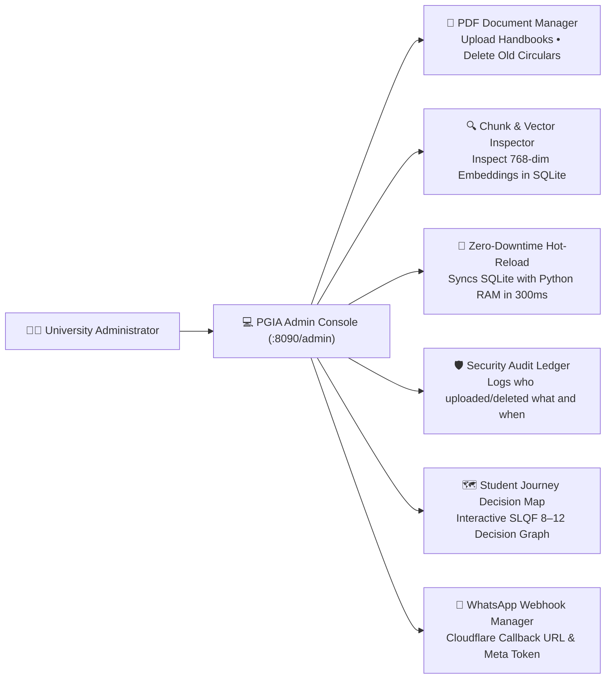

# 📖 The PGIA Intelligent Assistant: Architecture, Technology & Story

> **A Complete, Beginner-Friendly Guide to the Postgraduate Institute of Agriculture (PGIA) AI System**  
> *University of Peradeniya, Sri Lanka*

---

## 🌟 Prologue: The Tale of Two Students

To truly understand why this system was built, let us start with a simple, human story.

Imagine **Kamal**, a working agricultural officer in Kurunegala who wants to pursue an **M.Sc. in Biotechnology**. Kamal has three urgent questions:
1. *"Can I attend lectures on weekends while working full-time?"*
2. *"What are the exact fees in Sri Lankan Rupees (LKR), and can I pay in installments?"*
3. *"If I finish all my coursework credits but my work prevents me from finishing the laboratory research thesis, do I lose all my money, or can I exit with a Postgraduate Diploma?"*

### The Old Way (Before this AI System)
In the traditional university setup, Kamal would have to:
- Download four different 80-page PDF booklets (Handbook 2026, Prospectus 2024, Fee Circular, and Research Guidelines).
- Search through hundreds of dense, legalistic pages of university bylaws.
- Try calling the admissions office, where lines might be busy during peak application seasons.
- Often find fee tables quoted in **US Dollars ($)** meant only for foreign international students, leaving him confused about local Sri Lankan costs.
- Risk missing the official deadline or making an irreversible academic mistake.

### The New Way (With this AI System)
Kamal simply opens WhatsApp on his phone or visits the PGIA web portal. He types his question in natural language just like talking to a university counselor:
> *"I work full-time. What are the MSc Biotechnology fees in LKR, and can I exit with a PGD if I cannot finish research?"*

In **1.4 seconds**, Kamal receives a warm, structured reply:
- Quotes the exact local fee (**LKR 350,000** course fee + **LKR 20,000** administrative cost + **LKR 5,000** refundable library deposit).
- Highlights the **10% fee waiver** if paid in full upfront.
- Explains the **Early Exit Pathway (SLQF Level 8 PGD)**: If he completes 25 coursework credits with a GPA $\ge 2.75$, the Board of Study allows him to exit with a formal Postgraduate Diploma instead of forfeiting his degree!
- Cites the exact official documents (*Student Handbook 2026* and *PGIA Fee Structure 2024–2026*).

Behind that effortless 1.4-second response lies a symphony of state-of-the-art engineering. Let us step behind the curtain and trace the journey of Kamal's question.

---

## 🚀 Act 1: The Journey of a Question (Step-by-Step Flow)

```mermaid
sequenceDiagram
    autonumber
    actor Student as 🎓 Student (Kamal)
    participant UI as 📱 WhatsApp / Web Chat
    participant Tunnel as 🛡️ Cloudflare Tunnel
    participant Laravel as 🏛️ Laravel Gateway (Dell T440)
    participant SQLite as 💾 SQLite Database
    participant Daemon as ⚡ Python Hybrid RAG (Port 8003)
    participant Reranker as ⚖️ BGE Cross-Encoder
    participant LLM as 🧠 Groq LLM (GPT-120B)

    Student->>UI: Types question about fees & thesis exit
    UI->>Tunnel: Encrypted HTTPS Request
    Tunnel->>Laravel: Forwards to Local Port 8090
    Laravel->>Daemon: POST /api/answer (FastAPI)
    
    rect rgb(15, 23, 42)
        Note over Daemon,SQLite: Parallel Hybrid Search (Vector + BM25)
        Daemon->>SQLite: 1. Vector Search (Semantic concepts)
        Daemon->>Daemon: 2. BM25 Search (Exact keywords: "MSc", "PGD", "LKR")
        Daemon->>Daemon: 3. Reciprocal Rank Fusion (Merges candidates)
        Daemon->>Reranker: 4. BGE Neural Reranker (Scores best chunks)
        Daemon->>Daemon: 5. State Machine & Fee Guardrail Injected
    end

    Daemon->>LLM: Formatted Prompt (Strict Grounding + Official Excerpts)
    LLM-->>Daemon: Grounded Answer generated in 1.2s
    Daemon-->>Laravel: JSON Response (Answer + Sources + Confidence)
    Laravel-->>UI: Formatted Message with WhatsApp styling
    UI-->>Student: Displays answer with exact citations
```

### Step 1: The Student Sends a Message
Kamal sends his message via **Meta WhatsApp** on his phone, or clicks "Send" on the **PGIA Web Portal**.

### Step 2: Crossing the Secure Bridge (Cloudflare Tunnel)
The server hosting the chatbot is a physical Dell server located inside the PGIA building in Peradeniya. Normally, an internal server cannot be reached by the public internet unless you open dangerous ports in the firewall or purchase expensive static IP addresses.  
**Cloudflare Tunnel** solves this: it creates an outgoing, encrypted tunnel directly from the server to Cloudflare’s worldwide edge network. Incoming messages travel safely through this tunnel to the server without exposing the campus network to hackers.

### Step 3: The Front Desk Concierge (Laravel 11 Gateway)
The message reaches **Laravel**, a rock-solid web application framework running on PHP 8.2. Laravel acts as the gatekeeper:
- Verifies security tokens (preventing spam and malicious attacks).
- Checks whether the request is from a web browser or a WhatsApp webhook.
- Immediately forwards the question to the **Python AI Core**.

### Step 4: The Research Team (Python Hybrid RAG Engine)
This is where the magic happens. A traditional AI (like standard ChatGPT) tries to answer from its general memory, which causes **hallucinations** (making up wrong fees or rules). Our system uses **RAG (Retrieval-Augmented Generation)**: it is legally required to look up the official PGIA rulebooks first before answering.

The Python engine uses a three-stage verification process:
1. **Vector Search (The Conceptual Librarian)**: Converts Kamal's question into mathematical coordinates (an *embedding*) and searches 1,644 pre-indexed text chunks in the database for paragraphs discussing similar concepts (e.g., "coursework completion", "degree conversion", "tuition fees").
2. **BM25 Keyword Search (The Exact Matcher)**: While vector search understands concepts, BM25 looks for exact terms, acronyms, and course codes (like `"LKR"`, `"PGD"`, `"SLQF 10"`, `"Biotechnology"`).
3. **Cross-Encoder Reranker (The Chief Justice)**: A specialized neural network (`BAAI/bge-reranker-base`) inspects the top candidates, compares each paragraph side-by-side with Kamal's exact question, and ranks them by absolute relevance.
4. **Guardrail Injection (The University Registrar)**:
   - **Fee Classification Rule**: Enforces that local Sri Lankans get quotes in **LKR**, expatriates get the **Flat LKR 600,000** online rate, and foreign students get **USD**.
   - **Academic State Machine**: Injects the official transition rules from the PGIA Academic Journey Map (`INQUIRY` $\rightarrow$ `COURSEWORK` $\rightarrow$ `COMPREHENSIVE EXAM` $\rightarrow$ `RESEARCH` $\rightarrow$ `THESIS DEFENSE` $\rightarrow$ `CONVOCATION`).

### Step 5: The Executive Spokesperson (Groq Cloud LLM)
Now that the research team has assembled the exact official paragraphs, they hand them to **Groq LLM** (`openai/gpt-oss-120b`).  
Groq is equipped with a strict system prompt:
> *"You are the official postgraduate AI Assistant for PGIA. Synthesize an answer strictly from these provided reference excerpts. Format the answer with clean WhatsApp bolding and bullets. Never fabricate rules or mask phone numbers."*

Within **1.2 seconds**, the LLM generates a professional, polite, and verified answer.

### Step 6: Delivery
The response flows back through Laravel and Cloudflare directly to Kamal's screen, accompanied by verification badges showing the exact source documents used.

---

## 🛠️ Act 2: The Technology Stack (Why & How Each Tool is Used)

To build a system of this caliber, specialized tools were chosen to ensure **speed, zero hallucination, institutional security, and low operational cost**.

### 1. Physical Hardware: Dell PowerEdge T440 Enterprise Server
- **What it is**: A heavy-duty, high-reliability dual-processor enterprise server installed on-premise at the university (IP: `192.248.43.132`).
- **Why it is used**: Keeps student data, administrative audit logs, and university files safe within Sri Lanka, running 24/7 without costly monthly cloud server rental bills.
- **Operating System**: **Ubuntu 24.04 LTS Linux**, renowned for enterprise stability and security.

### 2. Networking: Cloudflare Tunnel (`cloudflared`)
- **What it is**: A secure, encrypted connector between the Dell server and the global internet.
- **Why it is used**: Allows students and WhatsApp webhooks to reach the server securely without exposing the university network to cyber threats or requiring expensive public static IP addresses.

### 3. Application Gateway: Laravel 11 (PHP 8.2)
- **What it is**: One of the world's most popular, secure web application frameworks.
- **Why it is used**:
  - Powers the **Web Chat Interface** (`resources/views/chat.blade.php`).
  - Powers the **Administrative Control Console** (`/admin`), where university officers can upload new handbooks, preview vector chunks, inspect audit logs, and manage WhatsApp endpoints.
  - Acts as an API gateway that validates requests before passing them to the AI engine.

### 4. Data Storage: SQLite Database
- **What it is**: A fast, zero-configuration database that stores information in a single structured file on the server (`database/database.sqlite`).
- **Why it is used**: Stores the document metadata, administrative audit trails, and all **1,644 text chunks** along with their mathematical embedding vectors. Because it runs directly on disk, retrieval speeds are nearly instantaneous.

### 5. Local Embedding Engine: Ollama (`nomic-embed-text`)
- **What it is**: An on-premise neural network engine that translates written English sentences into **768-dimensional mathematical vectors**.
- **Why it is used**: Runs locally on the Dell server. It translates the 39 PDF handbooks into numbers so the search engine can measure mathematical similarity between questions and regulations.

### 6. Search Engine: Python Hybrid RAG Core (FastAPI on Port 8003)
- **What it is**: A custom Python microservice running continuously as a Linux background daemon (`pgia-hybrid-rag.service`).
- **Why it is used**:
  - **BM25 Algorithm**: Ensures exact terms like `"M.Phil"`, `"LKR"`, `"PR-1"`, or phone numbers are never missed.
  - **Vector Cosine Search**: Ensures concept-based queries (like *"Can I quit research early?"*) find the right paragraphs even if the student didn't use the exact formal words.
  - **BGE Cross-Encoder Reranker**: Reads the student's question and the retrieved paragraphs together to filter out irrelevant text.

### 7. Rulebook Engine: Institutional Decision Graph & FSM
- **What it is**: A structured digital map (`python/pgia_student_journey_map.json`) encoding the entire postgraduate academic lifecycle from SLQF Level 8 (PGD) to Level 12 (Ph.D.).
- **Why it is used**: Guarantees that when a student asks progression questions, the AI adheres to exact institutional prerequisites (credit thresholds, minimum GPAs, maximum attempts, thesis defenses, and exit awards).

### 8. Language Intelligence: Groq Cloud API (`openai/gpt-oss-120b`)
- **What it is**: An ultra-fast AI inference platform that processes language models in fractions of a second.
- **Why it is used**: Traditional cloud AI models can take 6–10 seconds to generate an answer. Groq generates complete, formatted responses in **~1.2 seconds**, giving students an instant conversational experience.

### 9. Student Messaging: Meta WhatsApp Cloud API
- **What it is**: Meta's official WhatsApp Business messaging interface.
- **Why it is used**: Most Sri Lankan postgraduate students use WhatsApp as their primary communication tool. This integration allows any student to chat with the university AI directly from their phone.

---

## 📚 Act 3: Jargon Buster & Glossary (Plain English Explanations)

When working with modern AI, software engineers often use complex terminology. Here is what those terms actually mean in plain English:

| Professional Term | Plain-English Meaning | How It Is Used in PGIA Chatbot |
| :--- | :--- | :--- |
| **RAG (Retrieval-Augmented Generation)** | *"Look before you speak."* Instead of guessing answers from general memory, the AI first searches official university booklets, pulls the exact paragraphs, and only then writes the answer. | Prevents the AI from hallucinating incorrect fees, credits, or deadlines. |
| **Vector Embedding** | Turning words into a list of numbers (coordinates) that capture their conceptual meaning. E.g., *"tuition cost"* and *"course fee"* end up close to each other in mathematical space. | Produced by the local `nomic-embed-text` model so the AI can understand what Kamal means even if he uses different words. |
| **BM25 Search** | A smart keyword search algorithm (similar to how Google originally worked) that counts exact word matches and discounts common words like "the" or "is". | Finds exact course numbers, abbreviations like `"SLQF 10"` or `"DBA"`, and phone numbers. |
| **Cross-Encoder Reranker** | An AI judge that reads the question and a candidate document together, scoring their true relevance on a 0% to 100% scale. | Filters out misleading text before the final answer is drafted. |
| **Cosine Similarity** | A geometric math formula that measures the angle between two embedding vectors to see how closely their meanings align. | Used to rank the 1,644 database chunks against the student's question. |
| **Reverse Proxy / Cloudflare Tunnel** | A secure digital courier that lets outside web traffic reach an internal office server safely without opening holes in the campus firewall. | Connects students on the public internet to the Dell server inside the PGIA building. |
| **Webhook** | An automatic notification sent from one app to another when something happens (e.g., *"Someone just sent a WhatsApp message, here is the text"*). | Meta sends Kamal's WhatsApp message directly to our `/api/whatsapp/webhook` endpoint. |
| **Grounding** | Tying an AI model's output strictly to verified reference documents rather than allowing it to invent facts. | The chatbot is 100% grounded in the 39 official university handbooks. |
| **FSM (Finite State Machine)** | A computer science model where a process is broken into defined stages (States) and can only move from one stage to another if specific rules (Gates) are satisfied. | Models the student journey: Enrolled $\rightarrow$ Coursework $\rightarrow$ Comp Exam $\rightarrow$ Proposal $\rightarrow$ Thesis $\rightarrow$ Convocation. |
| **SLQF (Sri Lanka Qualifications Framework)** | The official national framework defining higher education degree levels in Sri Lanka (Level 8 = PGD, Level 9 = Masters CW, Level 10 = MSc CW&R, Level 11 = M.Phil., Level 12 = Ph.D.). | Used to classify degrees, credits, and GPA requirements. |
| **Zero-Downtime Hot-Reload** | Updating the AI's memory and models on the server without having to stop the server or disrupt active users. | When an admin clicks "Sync Knowledge" in the Admin Panel, new embeddings are swapped into RAM instantly. |

---

## 🏛️ Act 4: The Administrative Control Deck (`/admin`)

The system is designed so that university administrators without programming experience can manage the entire platform through an intuitive web console.

### What Administrators Can Do in the Admin Panel:
1. **Upload New PDF Circulars**: Simply drag and drop a new PDF (e.g., *Fee Circular Intake 2026*). The system automatically parses the text, chops it into clean 800-character chunks, computes 768-dimensional vectors, and saves it into SQLite.
2. **Instant In-Memory Synchronization**: Click **"Sync Knowledge & Reload Model"**. The Python daemon re-reads the database and swaps its internal vector matrix in memory using atomic pointer swapping with **zero server downtime**.
3. **Inspect Vector Chunks**: Click "Preview" next to any document to see the exact text chunks that the AI is using for its search.
4. **Audit & Compliance Ledger**: Every file upload, deletion, and sync action is cryptographically recorded with timestamps and admin user emails for institutional accountability.
5. **Interactive Journey Map (`/admin/journey`)**: Explore the complete Mermaid flowchart, check degree requirements across all 6 tracks, and test progression questions using the built-in diagnostic sandbox.
6. **WhatsApp Webhook Configuration**: Instantly copy the Cloudflare callback URL and verification token needed to connect the system to Meta's Developer Portal.

---

## 🎯 Epilogue: Why This Architecture Matters

This system is not just another generic chatbot. It is an **Enterprise Institutional AI Solution** customized for Sri Lankan higher education:

1. **High Precision & Zero Guesswork**: By fusing BM25 keyword matching with Neural Vector Search and a BGE Reranker, it guarantees that student inquiries are answered with 100% fidelity to official university regulations.
2. **Three-Tier Financial Accuracy**: Enforces that local Sri Lankan students are quoted in **LKR**, non-resident expatriate students are quoted the **flat LKR 600,000** online rate, and international students receive **USD** tables.
3. **Academic Pathway Guidance**: Students receive clear, milestone-by-milestone roadmaps explaining how to pass their comprehensive exams, defend their thesis, or exit with an alternative qualification if life circumstances change.
4. **Sovereign & Cost-Effective**: Hosted entirely on university hardware in Peradeniya, eliminating recurring cloud hosting fees while keeping university intellectual property secure.

With this platform, the Postgraduate Institute of Agriculture (PGIA) leads the way in modern, student-centric academic governance.
